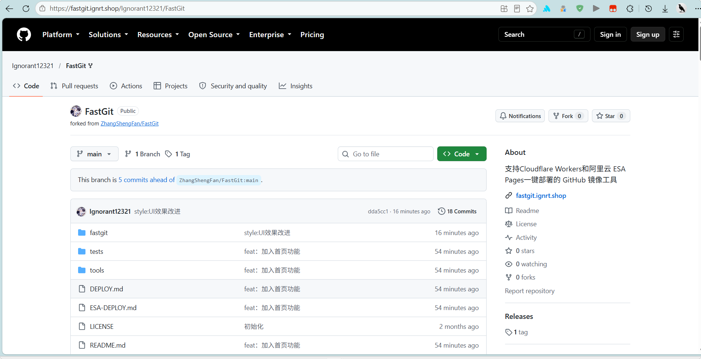
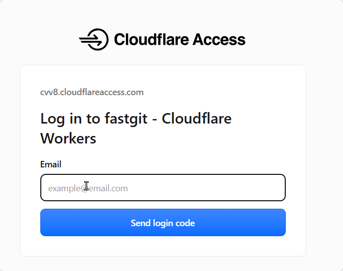

<div align="center">

# FastGit — GitHub 镜像加速

**部署一个边缘函数，把 `github.com` 换成你自己的域名即可访问。**  
网页、静态资源、Raw 文件、Release 附件、仓库压缩包，以及 Git Smart HTTP 请求全部走镜像代理。

[](LICENSE)
[](https://workers.cloudflare.com)
[](https://www.aliyun.com/product/esa)
[](https://linux.do)

**[📖 Cloudflare 部署教程](DEPLOY.md)　·　[📖 阿里云 ESA 部署教程](ESA-DEPLOY.md)**

</div>

---

## 功能特性

<div align="center">

首页


历史记录


GitHub加速



可以设置登录验证Access



</div>

| 功能 | 说明 |
|------|------|
| 加速首页 | 打开镜像域名显示 FastGit 首页，粘贴链接即可生成加速地址 |
| 默认走本站 | 首页默认加速节点取当前域名，换成任何自定义域名都通用 |
| GitHub 网页镜像 | 仓库路径显示 GitHub 官方界面 |
| 静态资源代理 | 头像、图片、CSS/JS 等静态资源自动改写到镜像 |
| Raw 文件代理 | `raw.githubusercontent.com` 内容通过镜像访问 |
| Release 代理 | 版本发布附件、源码压缩包可正常下载 |
| Git Smart HTTP | 支持 `git clone`、`git fetch` 等命令 |
| 完整链接透传 | 支持 `<镜像域名>/https://github.com/owner/repo` 写法 |
| 双平台部署 | 同时支持 Cloudflare Workers 与阿里云 ESA Pages |
| 可选网页登录 | 默认关闭，按需通过环境变量开启 |
| 域名白名单 | 只允许访问 GitHub 相关上游域名 |
| 国内外分流 | 海外访客直接跳转 GitHub，国内访客走镜像代理 |
| 健康检查页 | `/healthy` 显示上游状态、版本、耗时 |
| 分流诊断 | `/__fastgit/diagnostics` 显示识别地区、生效配置与分流决策 |

---

## 架构说明

```
浏览器
  │
  ▼
Cloudflare Workers / 阿里云 ESA
  │  worker-cloudflare.js / worker-esa.js
  │  按访客地区判断：海外跳转上游，代理地区继续处理
  │  代理网页、静态资源、Raw、Release、Git Smart HTTP
  ▼
GitHub 上游（github.com / raw.githubusercontent.com / codeload.github.com ...）
```

---

## 项目结构

```
FastGit/
├── worker-cloudflare.js     # Cloudflare Workers 入口
├── wrangler.jsonc           # Cloudflare Workers 部署配置
├── worker-esa.js            # 阿里云 ESA Pages 入口
├── esa.jsonc                # 阿里云 ESA Pages 构建配置
├── fastgit/                 # 加速首页（index.html / styles.css / app.js）
├── tools/embed-fastgit.mjs  # 把首页资源内联进两个 Worker 入口
├── DEPLOY.md                # Cloudflare Workers 部署教程
├── ESA-DEPLOY.md            # 阿里云 ESA Pages 部署教程
├── tests/                   # CSP 和路由分流回归测试
└── LICENSE
```

> 两个 Worker 入口是「整文件粘贴部署」的单文件形式，所以首页资源被内联在其中。修改 `fastgit/` 后运行 `node tools/embed-fastgit.mjs` 重新生成内联内容（`fastgit/` 本身仍可直接用浏览器打开做本地测试）。

---

## 快速部署

> 完整教程见 **[Cloudflare 部署教程](DEPLOY.md)** / **[阿里云 ESA 部署教程](ESA-DEPLOY.md)**

### Cloudflare Workers

1. 登录 [Cloudflare Dashboard](https://dash.cloudflare.com/)。
2. **Workers & Pages** → **Create application** → **Create Worker**，命名后部署。
3. Worker **Overview** → **Edit code**，删除示例代码，粘贴 [worker-cloudflare.js](worker-cloudflare.js) 全部内容。
4. 点击 **Deploy**。
5. 打开 `*.workers.dev` 地址验证是否可用，需要自定义域名参考 [DEPLOY.md](DEPLOY.md)。

> 粘贴的是包含首页的完整单文件，部署后访问根路径即显示 FastGit 加速首页。

### 阿里云 ESA Pages

1. 进入 ESA 控制台 **边缘计算和 AI** → **函数和 Pages**。
2. **创建** → **导入 GitHub 仓库**，选择本仓库 `main` 分支。
3. `esa.jsonc` 会自动指定 `worker-esa.js` 为入口，无需额外配置。
4. **开始部署**，完成后绑定自定义域名。

---

## 使用方式

打开 `https://git.example.com/` 即是 FastGit 加速首页：粘贴链接、回车，即可在新标签页打开加速地址，默认节点就是当前域名（`gh-proxy.com` 作为备用节点保留）。

也可以把链接里的 `github.com` 换成部署域名来直接访问：

```text
GitHub：https://github.com/cloudflare/workers-sdk
镜像：https://git.example.com/cloudflare/workers-sdk
```

克隆仓库：

```powershell
git clone https://git.example.com/owner/repository.git
```

替换已有仓库的远程地址：

```powershell
git remote set-url origin https://git.example.com/owner/repository.git
git fetch origin
```

---

## 配置项

| 变量 | 默认值 | 说明 |
|------|--------|------|
| `ALLOW_LOGIN` | `false` | 设为 `true` 才允许通过镜像打开 GitHub 登录页 |
| `SOURCE_REPOSITORY` | `ZhangShengFan/FastGit` | `/healthy` 显示版本信息时读取的仓库 |
| `CACHE_TTL` | `3600` | 静态资源缓存秒数，`0` 关闭缓存，最大 `86400` |
| `PROXY_COUNTRIES` | `CN` | 逗号分隔的国家/地区代码（ISO 3166-1 alpha-2），仅这些地区走代理，其余直接跳转 GitHub；设为 `*` 表示所有访客都走代理（关闭分流）|

Cloudflare Workers：**Settings** → **Variables and Secrets**  
阿里云 ESA：项目 **基本信息** → **构建信息** → **修改**

---

## 注意事项

- 默认不要开启 `ALLOW_LOGIN`；开启后 GitHub 登录表单、验证码、浏览器会话都会经过你的边缘函数，只适合自用实例
- 分流依赖访客 IP 归属地：Cloudflare 读取 `cf.country`，ESA 需在站点开启**添加访问者位置标头**（注入 `ali-ip-country`）。使用代理或 VPN 的访客可能被判定为海外而直接跳转 GitHub
- 海外访客返回 `302`（GET/HEAD）或 `307`（其它方法，保证 git 等请求不丢方法与正文）跳转到真实 GitHub；`/healthy`、`/__fastgit/diagnostics`、登录禁用页等本地页面不受影响
- 通行密钥、部分风控流程仍可能要求原始 `github.com` 域名，镜像下不保证生效
- 自定义域名建议直接用平台的 Custom Domain，不要叠加多层 CNAME，否则 Git 客户端可能 TLS 握手失败
- 不记录 Cookie、Authorization、令牌、表单内容或请求正文；不缓存私有内容和下载文件

---

## 完整链接访问

也支持把完整的 GitHub 链接直接拼在镜像域名后面（gh-proxy 风格的链接透传）：

```text
镜像：https://git.example.com/https://github.com/cloudflare/workers-sdk
```

对于需要代理的访客，完整链接的 `GET`/`HEAD` 请求会先返回 `302`，跳转到镜像内的标准路径，查询参数会保留：

| 输入路径 | 镜像内跳转目标 |
| --- | --- |
| `/https://github.com/A/B` | `/A/B` |
| `/http://github.com/A/B` | `/A/B`，上游使用 HTTPS |
| `/https://github.com/A/B?tab=readme` | `/A/B?tab=readme` |
| `/https%3A%2F%2Fgithub.com%2FA%2FB` | `/A/B` |
| `/https://raw.githubusercontent.com/A/B/main/x.txt` | `/_proxy/raw.githubusercontent.com/A/B/main/x.txt` |

标准路径 `/A/B` 直接代理，无需上述跳转。对于海外访客，优先按分流规则跳转真实 GitHub。其他方法的请求继续透传，保留方法和请求体；非白名单上游域名会被拒绝。

GitHub 前端路由需要浏览器路径与页面的 `initial-path` 一致。直接在 `/https://github.com/…` 路径下返回仓库 HTML，会导致部分提交信息请求未正常初始化；先跳转到标准路径可解决这个问题。建议日常使用和分享标准镜像路径。

## 国内外分流

通过 `PROXY_COUNTRIES` 按访客 IP 归属地分流：国内访客走镜像代理，海外访客直接跳转真实 GitHub。

```text
国内（默认 CN）：https://git.example.com/cloudflare/workers-sdk  →  走代理
海外（其它地区）：https://git.example.com/cloudflare/workers-sdk  →  跳转 https://github.com/cloudflare/workers-sdk
```

- 默认 `PROXY_COUNTRIES=CN`，只代理中国大陆；可改为 `CN,HK,MO,TW` 等逗号分隔列表
- 设为 `*` 关闭分流，所有访客都走代理
- 无法识别归属地时一律走代理，避免误伤国内访客
- 归属地来源：Cloudflare 读取 `cf.country`；ESA 需在站点开启**添加访问者位置标头**（`ali-ip-country`）
- `GET`/`HEAD` 返回 `302`，其它方法（如 git push）返回 `307`，保证方法与请求体不丢失；`/healthy`、`/__fastgit/diagnostics`、登录禁用页等本地页面不受影响

## 常见问题

### Cloudflare Workers 免费额度如何消耗

以下额度于 **2026-10-16** 核对，后续以 Cloudflare 官方[定价文档](https://developers.cloudflare.com/workers/platform/pricing/)和[限制文档](https://developers.cloudflare.com/workers/platform/limits/)为准：

| 项目 | Workers Free |
| --- | --- |
| 请求数 | 账户每天 100,000 次，UTC 零点重置，即北京时间早上 8 点 |
| CPU 时间 | 每次调用最多 10 ms；等待上游网络响应不计入 CPU 时间 |
| 子请求 | 每次调用最多 50 个子请求 |

本项目中，一次打开网页通常包含 HTML、JS、CSS、图片和异步接口等多次请求，不能把一次页面访问等同于一次 Worker 调用：

| 场景 | 消耗情况 |
| --- | --- |
| 请求到达 Worker | 每次调用计入请求额度，包括返回重定向和诊断信息 |
| 命中 `caches.default` | 仍调用 Worker，但省去上游抓取和内容改写 |
| 浏览器直接使用本地缓存，未发出请求 | 不调用 Worker |
| Worker 内部 `fetch()` GitHub | 属于子请求，不额外算作一次客户端调用 |
| 海外访客跳转真实 GitHub | 初始跳转计一次；后续直接访问 GitHub 不经过该 Worker |
| 完整链接跳转镜像标准路径 | 比直接访问标准路径多一次调用 |

当前边缘缓存仅覆盖 `github.githubassets.com` 的静态资源，默认 `CACHE_TTL=3600`。头像、仓库 HTML、异步数据接口不在此缓存范围内。可通过 `X-Mirror-Cache: HIT` / `MISS` 查看符合条件的资源是否命中边缘缓存。

文本替换和 CSP 哈希计算会消耗 CPU，大型 JS 在缓存未命中时需要完整读取并改写。建议保留静态缓存，日常使用标准仓库路径，并在 Cloudflare Dashboard 观察请求数、CPU 时间和超限错误。实际容量取决于每页资源数量、浏览器缓存与访问行为，不保证固定的每日页面访问量。

---

## License

[MIT License](LICENSE)

## 友链

<div align="center">

[](https://linux.do)

</div>
